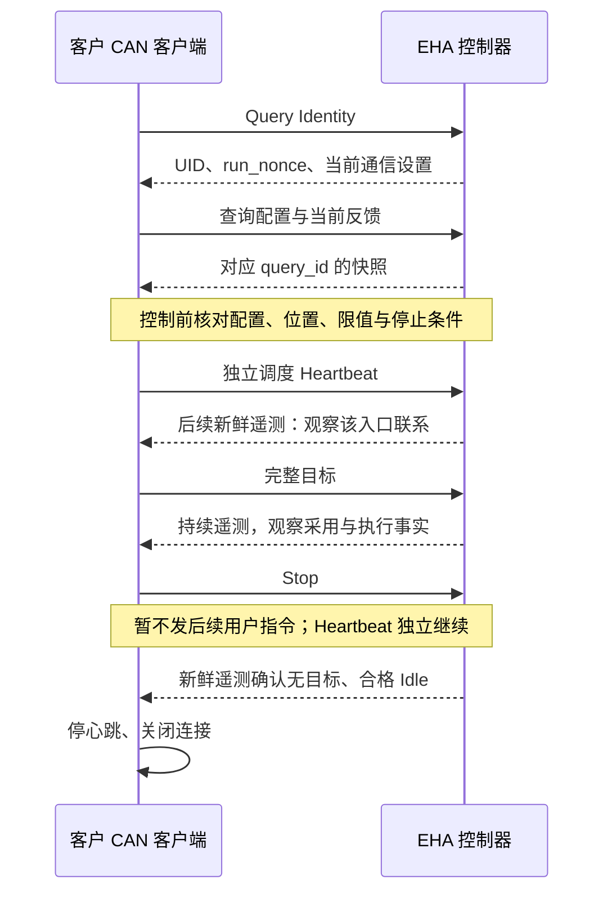

<!-- Copyright The eha-sdk Contributors -->

# 客户 CAN 接入指南

本指南组织自行实现 CAN 客户端的接入顺序，不要求 Rust SDK。线上字节和分片以
[公共应用通信协议](docs/通信协议/公共应用通信协议.md)、[CAN 绑定](docs/通信协议/CAN通信绑定.md)为准；
目标、停止和结果处理共用[公共交互规则](README.md#公共交互与结果)。

## 接入前提与职责

部署方提供控制器本次启动采用的节点号、Classic／FD 配置组和总线访问条件。节点号
`config.external_can.id` 是逻辑值，不是原始 CAN ID；不能猜测默认值，或用同型设备、USB
描述符替代身份。取得 Identity 后再读配置视图核对实际设置。

| 客户端负责 | 实现要点 |
|---|---|
| 完整消息 | 公共头、精确长度和 CRC32C；不补字段，不把 CAN 填充计入消息 |
| 分片与重组 | 冻结完整消息；维护每方向、节点、通道的编号保护、组装期限和通信世代 |
| 查询关联 | 非零且递增、不复用的 `query_id`；Identity 后绑定 UID、`run_nonce` 和类别 |
| 联系维持 | 独立调度显式 `Heartbeat`；普通流量和本地定时器不能代替设备收到心跳 |
| 保存与重启 | 携带预期 UID、`run_nonce`；只报告本地提交，超时或断连不自动重发。需要核对时由用户显式重连并读取当前配置 |

## 主机 CAN 通道

SDK 的 `CanChannel` 只发送和接收原始帧：Rust 应用以 `CanChannelFactory` 接入自己的系统／驱动服务，SDK 不发现、初始化或恢复物理 CAN 设备，也不解释厂商协议或指定比特率。Python 不是公共协议或 Rust SDK 的必需依赖。

官方 `eha-tool` 提供两条明确边界的接入路径。普通路径使用每用户 `connections.json` 中保存的连接档案：macOS/Linux 优先使用 `XDG_CONFIG_HOME/eha-tool/connections.json`；未设置时，macOS 为 `~/Library/Application Support/eha-tool/connections.json`，Linux 为 `~/.config/eha-tool/connections.json`。Windows 忽略 `XDG_CONFIG_HOME`，使用 `%LOCALAPPDATA%/eha-tool/connections.json`（未设置时回退 `%APPDATA%/eha-tool/connections.json`）。工具只支持其中 `adapter.kind="canable2"` 的 CANable2/SLCAN 档案：按保存的稳定 USB 序列号寻找唯一串口，并应用 1 Mbps 仲裁速率、2 Mbps FD 数据速率的预设。它不识别或实现厂商 USB 协议，也不尝试复位或恢复驱动。

连接档案包含名称、适配器序列号、EHA 节点、帧形态、可选自动连接与默认标记；`connection save` 先通过 Identity 和已有 UID 门禁，才写入或绑定预期 EHA UID，Python 路径只用于本次操作而不写入档案。普通用户用 `connection adapters [--can-python PATH]` 列出候选、`connection list` 查看档案，再用下列命令保存、连接或删除档案：

```sh
eha-tool connection save ID --name NAME --serial SERIAL --node N \
  [--mode fd] [--default] [--autoconnect] [--can-python PATH]
eha-tool connection connect ID [--can-python PATH] [--timeout-secs N]
eha-tool connection delete ID
eha-tool device --connection ID ACTION
```

精确参数和输出以各子命令的 `--help` 为准。发布 bundle 通过私有 `runtime/python` 运行已锁定的 `python-can==4.6.1` 和 `pyserial==3.5`，因此普通使用不依赖 `PATH`、`pip`、虚拟环境或 `can.conf`。

同序列号候选不唯一、适配器缺失、通道打不开、Identity 失败或返回 UID 不等于档案预期 UID 时，工具拒绝连接；绝不改用另一串口、适配器、USB 或历史目标。首次连接和物理重连只执行 Identity：不自启 Heartbeat、不恢复控制、不重放目标或维护操作。用户先处理实际物理连接，再显式发起通信恢复。

更换电脑时下载与该主机系统和 CPU 架构一致的完整发行包并整体解压，在新主机首次执行 `connection adapters`，选择实际可见适配器并 `connection save`，再显式连接；普通路径不需要手改设备路径、Python 或 `can.conf`。档案保存在运行 backend 的该用户目录，不在浏览器中；换 CAN 适配器须新建档案或明确重新绑定，旧档案不会静默指向新硬件。一个运行中的 WebUI CAN 网络绑定其首次打开的适配器；要切换到另一档案/适配器，先结束该网络上的会话，再重启 WebUI 后连接。

高级路径保留 `--can-channel CONTEXT --node N [--can-mode classic|fd] [--can-python PATH]`，供其它 `python-can` 后端使用。随包 runtime 也可运行其中已包含依赖的后端；当某厂商后端还需要厂商 SDK、Python 包或解释器环境时，再用 `--can-python PATH` 显式覆盖为自备 Python。`CONTEXT` 仍按 `python-can` 的命名配置或等价 `CAN_CONFIG_<CONTEXT>` 环境配置提供；调用方负责所选设备的驱动、权限、总线设置及恢复。`--can-mode` 和 SDK 的 `transport::can::Mode` 只选择 EHA CAN 绑定所要求的帧形态，必须与控制器实际启动配置一致；`fd` 仍要求操作系统、驱动和设备实际支持 CAN FD 与 BRS。可参照 [python-can 配置说明](https://python-can.readthedocs.io/en/stable/configuration.html) 与 [总线接口](https://python-can.readthedocs.io/en/stable/bus.html)。

发布包按下表的 OS／架构组合构建；请从工作流产物或已发布发行包中选择相符的一项，解压后保留完整目录，不要移动 `eha-tool`／`eha-tool.exe`、`runtime/` 或其中的文件。当前工作流可以产出这些包，但不等同于已发布下载地址或实际 CAN 硬件验证。

| 主机 | CPU | 打包目标 | 归档与入口 |
| --- | --- | --- | --- |
| macOS | arm64 | `aarch64-apple-darwin` | `tar.gz`，`./eha-tool webui` |
| Linux（GNU glibc，最低 2.35） | amd64 | `x86_64-unknown-linux-gnu` | `tar.gz`，`./eha-tool webui` |
| Linux（GNU glibc，最低 2.35） | arm64 | `aarch64-unknown-linux-gnu` | `tar.gz`，`./eha-tool webui` |
| Windows 10/11 | amd64 | `x86_64-pc-windows-msvc` | `.zip`，PowerShell 中 `./eha-tool.exe webui` |
| Windows 11 | arm64 | `aarch64-pc-windows-msvc` | `.zip`，PowerShell 中 `./eha-tool.exe webui` |

Linux 包以 Ubuntu 22.04 构建，面向 GNU glibc 系统；Alpine/musl 不在该包的运行范围。Windows 包含 `eha-tool.exe`、`runtime/python/python.exe` 和随 Python runtime 提供的 VC runtime 文件，用户不需安装 Python、pip 或 MSVC。设备驱动、访问权限、实际总线条件及厂商 SDK 仍由适配器和操作系统决定。

发布包制作者在对应目标的本机／原生 CI runner 构建工具与 runtime；`package_tool.py` 拒绝在不匹配系统或 CPU 架构的宿主上制包，二进制须由对应 target 构建。具体制包维护方式见[贡献指南](CONTRIBUTING.md#依赖)。

输出目录含 `eha-tool`（Windows 为 `eha-tool.exe`）与 `runtime/`；这只证明包已生成，不证明任一 CAN 适配器、EHA 身份、总线、控制或机构效果。驱动打开、写调用返回或工具显示“已连接”也只证明本地阶段；仍以同一通路的 Identity 核对身份与通信设置。

## 报文定义入口

Classic 和 FD 重组后的完整消息须逐字节一致。按下表实现规则，再用样例核对：

| 需要实现的部分 | 唯一维护位置 |
|---|---|
| 公共消息头、长度、字节顺序、CRC32C | [完整消息与基本表示](docs/通信协议/公共应用通信协议.md#2-完整消息与基本表示) |
| 命令、回复及各业务字段 | [消息目录](docs/通信协议/公共应用通信协议.md#3-消息目录)和[公共交互与结果](README.md#公共交互与结果) |
| 节点号、速率配置与 Classic／FD 帧形态 | [启动配置与帧形态](docs/通信协议/CAN通信绑定.md#1-启动配置与帧形态) |
| 扩展 ID 的组成、方向、通道、传输编号与片序 | [扩展标识符](docs/通信协议/CAN通信绑定.md#2-扩展标识符) |
| 分片长度、DLC 与末片填充 | [公共消息和分片载荷](docs/通信协议/CAN通信绑定.md#3-公共消息和分片载荷) |
| 乱序、重复、超时、编号重用及连接恢复 | [组装、失效和重连](docs/通信协议/CAN通信绑定.md#4-组装失效和重连) |
| 实际发送结果与完整消息交付的区别 | [接收分类和发送边界](docs/通信协议/CAN通信绑定.md#5-接收分类和发送边界) |

## 查询、心跳与保存重启



遥测独立发布，不是逐心跳或逐目标确认；图中箭头不承诺消息送达或指令被采用。固件收到的 `Stop` 独立保留，后续查询不能覆盖它；本地发送仍不能证明停止执行。首次 Identity 查询可尚不知道运行实例，后续
`Query`、`ReadConfig` 必须按[运行实例与快照](docs/通信协议/公共应用通信协议.md#4-运行实例快照和通用字段)关联回复。

`SaveAndRestart` 携带完整配置和预期 UID、`run_nonce`；准入后保存并重启，不再继续本次应用。`ResetApplication` 和 `EnterUpdate` 使用同样的身份核对。具体规则见[公共协议](docs/通信协议/公共应用通信协议.md)：没有操作键、历史结果查询或释放；本地发送、CAN ACK、断连和新运行实例均不证明保存成功。需要核对时，用户显式重连同一 UID，读取 `UserRecord`、`Startup` 和启动来源，确认当前实际状态。SDK 不代替用户执行这一流程。

## 可核对报文

使用[公共协议的可复算样例](docs/通信协议/公共应用通信协议.md#13-可复算样例与失败场景)
与[CAN 绑定的代表性承载](docs/通信协议/CAN通信绑定.md#8-代表性承载)核对独立实现：

| 场景 | 核对内容 |
|---|---|
| 主机 Heartbeat | `node=1`、主机到固件、`transfer_id=1` 的扩展 ID、8 B 数据与 Classic／FD 一致的承载。 |
| Position `10 mm` | 同一完整 12 B 公共消息在 Classic 的两帧与 FD 的一帧之间逐字节重组一致。 |

这些例子只证明编码、分片和重组是否符合合同；不证明目标已采用、控制仍获准、设备已经
执行，或维护操作已经完成。
