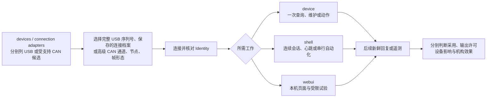
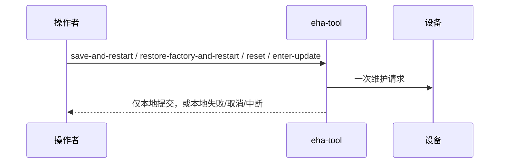

<!-- Copyright The eha-sdk Contributors -->

# `eha-tool`

`eha-tool` 是 EHA 的官方命令行工具，提供单次 CLI、持久 Shell 和本机 WebUI。它通过
[`eha-sdk`](../../README.md)访问**明确选择**的控制器；协议、配置格式和客户接入规则仍由 SDK
维护。本文说明工具旅程和资源边界；精确的命令、参数、默认值和版本以
`eha-tool --help` 及对应子命令的 `--help` 为准。构建、安装和检查入口见
[根贡献指南](../../CONTRIBUTING.md)。

`eha-tool webui` 是持续维护的图形入口，可继续开发功能、修复问题和更新测试。

### 发行包

从工作流产物或已发布发行包选择与主机匹配的包，整体解压后运行：macOS/Linux 使用
`./eha-tool webui`，Windows 在 PowerShell 使用 `./eha-tool.exe webui`。不要单独移动可执行文件；同级
`runtime/` 提供固定的 Python 和 CAN 依赖，因此普通 CANable2/SLCAN 连接不需要安装 Python、pip 或配置
`can.conf`。发行包覆盖 macOS arm64、Linux GNU glibc amd64/arm64、Windows amd64 和 Windows 11 arm64；Linux
需要 glibc 2.35 或更高，不支持 Alpine/musl。连接档案路径、适配器切换和高级后端条件见
[CAN 接入指南](../../CAN接入指南.md#主机-can-通道)。

## 使用方式

### 命令行

先选入口，再建立证据：



枚举不会打开设备或扫描总线，不能说明连接或 Identity 已核对。`device` 的每个动作新建本地
会话、核对 Identity、执行一个动作后关闭本地句柄；单次调用返回后不保留会话、心跳或 USB 传输编号及其保护状态。因此两个独立 USB `device` 进程不构成同一串行会话；连续查询、维护核对或脚本自动化使用已有的 `shell --batch`，在同一 SDK 会话内完成，不把独立调用的超时自动重发。USB 目标使用完整
序列号；CAN 目标可选已保存的 `--connection ID`，或给出高级 `--can-channel` 与 `--node`，可选
`--can-mode classic|fd`（默认 `fd`）和 `--can-python` 指定带 `python-can` 的解释器。受管档案仅支持
CANable2/SLCAN：它按保存的稳定 USB 序列号选择唯一串口，并应用 1 Mbps／2 Mbps FD 预设；发行包自带运行它的
Python runtime。其它后端的通道上下文、设备权限和总线参数仍由部署方配置。`--can-mode` 必须匹配设备实际启动的
Classic／FD 帧形态。详见 [CAN 接入指南](../../CAN接入指南.md#主机-can-通道)。

| 需要 | 入口 | 关键边界 |
| --- | --- | --- |
| 本地完整配置检查 | `config-check FILE` | 不访问设备。 |
| 候选发现 | `devices` | `--json` 供自动化；只枚举 USB 候选，不发现 CAN 设备。 |
| 管理受管 CAN 档案 | `connection adapters\|list\|save ID\|connect ID\|delete ID` | 仅 CANable2/SLCAN；按稳定 USB 序列号选择唯一候选，`save` 先通过 Identity/已有 UID 门禁才保存绑定。 |
| 单次查询、维护或控制提交 | `device TARGET ACTION` | 动作前核对 Identity；`--timeout-secs` 默认 5 秒；`device --json` 输出结构化结果。 |
| 单次观察或心跳 | `device TARGET telemetry SECONDS`、`heartbeat-test SECONDS` | 前者不启动心跳或提交控制；后者只显式启停心跳，不发送 Stop。 |
| 连续会话或串行自动化 | `shell` | 同一 SDK 会话可保留心跳和缓存遥测。 |
| 本机页面、试验和记录 | `webui` | 仅监听 `127.0.0.1`。 |
| ODrive USB 只读快照 | `odrive` | 与 H723 会话独立，不控制设备。 |

以下值是占位符，执行前必须替换为已核对的实际目标。普通用户先保存一个受管连接档案；档案只持久于当前用户，
不写入 `can.conf`，也不要求选择 Python。CAN 上下文是高级入口中部署方在外部驱动配置的名称，
不是设备路径或工具默认猜测的标识。

```sh
export EHA_USB_SERIAL='实际完整 USB 序列号'
export EHA_CAN_CHANNEL='EHA_PRODUCTION'
export EHA_CAN_NODE='实际 Customer CAN 节点号'
export EHA_CAN_MODE='fd'
export EHA_CONNECTION='已保存的档案 ID'

eha-tool devices --json
eha-tool device --usb "$EHA_USB_SERIAL" inspect
eha-tool connection adapters
eha-tool connection list
eha-tool connection save bench --name '台架' --serial '适配器完整序列号' --node 1 --default
eha-tool connection connect bench
eha-tool device --connection "$EHA_CONNECTION" status
eha-tool device --can-channel "$EHA_CAN_CHANNEL" --node "$EHA_CAN_NODE" --can-mode "$EHA_CAN_MODE" status
```

受管档案在连接成功前不拥有目标；每次连接都由 Identity 核对并写入或比对预期 EHA UID。串口缺失、候选歧义、
通道错误或 UID 不符都会停止，不回退其它适配器、USB 或旧目标。`connection connect` 与 `device --connection`
只完成连接和所请求的业务；不启动心跳、不恢复控制或重放旧操作。`--can-python PATH` 仅覆盖本次操作，不保存到档案。物理断开后先恢复实际连接，再由用户显式执行连接。
`inspect --json` 只输出身份、运行实例和更新路由；`--version` 不访问设备。无参数仅在标准输入和输出
都是终端时进入 Shell；管道或重定向中无参数只显示帮助。

#### 控制与停止

`position MM`、`velocity MM_S`、`force N` 与
`impedance EQUILIBRIUM_MM STIFFNESS_N_PER_MM DAMPING_NS_PER_MM` 都提交持续目标；`velocity 0`
仍是速度目标。提交结果仅表示本地 I/O 完整提交，不能证明设备采用、输出允许、ODrive 执行或机构运动。
进程退出、超时、断连、关闭连接或停止心跳都不表达停止意图；普通停止必须对同一设备显式执行 `stop`。
之后读取本次目标之后的新遥测，结合目标、输出条件、接收年龄和未知影响判断设备事实。

```sh
eha-tool device --usb "$EHA_USB_SERIAL" position 12.5
eha-tool device --usb "$EHA_USB_SERIAL" velocity 1.0
eha-tool device --usb "$EHA_USB_SERIAL" force 100.0
eha-tool device --usb "$EHA_USB_SERIAL" impedance 12.5 5.0 0.2
eha-tool device --usb "$EHA_USB_SERIAL" stop
```

`velocity-test MM_S SECONDS` 是唯一内建的短时速度编排：速度必须是非零有限值，时长 1 至 10 秒，且
不超过从实际 Startup 配置读取的速度软幅值。它核对 Identity、Startup、初始 Idle 和通路联系，显式启停
心跳、显式发送一次 Stop 并等待停止条件；不支持 `--json`。成功只说明该流程的通信和停止条件，不能替代
机构行程、负载或安装条件的核对。

```sh
eha-tool device --usb "$EHA_USB_SERIAL" velocity-test 1.0 2
```

#### ODrive USB 只读

ODrive USB 是独立只读入口：不清错、重启、保存、标定、喂狗或提交控制，也不能证明 H723 与 ODrive
之间的 CAN 状态。`--python PATH` 必须指向带 `odrive==0.5.1.post0` 的解释器；省略时依次使用
`EHA_ODRIVE_PYTHON`、`python3`。`--timeout-secs` 范围为 1 至 60，`--json` 在失败时也输出 JSON。

```sh
eha-tool odrive devices
eha-tool odrive status --serial 0x0123456789AB
eha-tool odrive --python /path/to/python --timeout-secs 10 --json status --serial 0x0123456789AB
```

#### 持久 Shell

`eha-tool shell`（或终端中的无参数调用）持有一个 SDK 会话。交互式无脚本启动时，工具可对唯一已绑定 UID 的自动连接档案只尝试一次；失败保留 Shell，不会循环重连。先用 `device list` 取得候选，以完整序列号
或该次列表中的短数字序号 `device select`，再 `device connect`；CAN 直接使用
`device connect-can CONTEXT NODE [classic|fd] [PYTHON]`，或使用受管档案 `device connect-saved ID [--python PATH]`。连接和 `device reconnect` 都核对 Identity。
`device show`、`device clear`、`device snapshot`、`device disconnect` 管理本地选择或会话；Shell 不发现 CAN
设备，`CONTEXT` 由外部驱动配置。

| Shell 工作 | 命令 | 边界 |
| --- | --- | --- |
| 查询 | `status`、`measurements`、`diagnostics`、`telemetry` | `telemetry` 只读缓存，不发查询；`wait SECONDS` 只本地等待。 |
| 联系 | `heartbeat-start`、`heartbeat-stop`、`heartbeat-once` | 启停心跳不停止控制。 |
| 持续目标与普通停止 | `position`、`velocity`、`force`、`impedance`、`stop` | 仍须显式 `stop`。 |
| 配置与维护 | `config check FILE`、`config-read`、`save-and-restart`、`restore-factory-and-restart`、`reset-application`、`enter-update` | `config check` 不连接；其余规则见[配置与维护](#配置与维护)。 |

`disconnect`、`reconnect`、`quit` 和关闭 Shell 只管理本地连接，不会发送 Stop、Reset 或重放动作。交互式
Shell 按 shell 语法分词但不展开环境变量；用 `help`、`help device`、`help config` 查询精确帮助。

`shell --script FILE` 与 `shell --batch` 共用一个会话，逐行执行并在首个错误停止，绝不重发。批处理忽略
空行和以 `#` 开头的整行；交互 Shell 的 `#` 不是注释。批处理中的 `help` 以非零状态结束，因此应预先
查看帮助。每个脚本自行完成候选选择与连接。

```sh
eha-tool shell --script ./session.eha
eha-tool shell --batch <<EOF
device list
device select "$EHA_USB_SERIAL"
device connect
status
EOF
```

#### 配置与维护

`config-check` 完成 SDK 静态配置检查；字段、schema 和换算规则见
[SDK 配置检查](../../README.md#配置检查)。通过不代替设备身份、通信或运行
条件核对。`config-read --view` 接受 `factory`、`user`、`startup`；完整 UTF-8 记录可用 `--output` 创建新文件，且工具不覆盖已有文件。Shell 使用 `save-and-restart FILE` 和
`config-read --view VIEW`，不提供 `--output` 导出。



`save-and-restart`、`restore-factory-and-restart`、`reset-application` 与 `enter-update` 都只报告本地提交；本地 Submitted 前可返回当前关联的明确拒绝，但不等待设备完成、断连、复位或读回，也不自动重连、查询或重发。保存和恢复出厂都请求设备重启，后续是否保存、采用 Startup 或进入更新入口须由操作者显式重新连接并读取当前事实。`enter-update` 不传输镜像；镜像传输、DFU 对象核对和新应用启动核对由外部更新流程负责。

```sh
eha-tool device --usb "$EHA_USB_SERIAL" config-read --view user --output ./before.json
eha-tool device --usb "$EHA_USB_SERIAL" save-and-restart ./candidate.json
eha-tool device --usb "$EHA_USB_SERIAL" restore-factory-and-restart
eha-tool device --usb "$EHA_USB_SERIAL" reset-application
eha-tool device --usb "$EHA_USB_SERIAL" enter-update
```

### Web UI

`webui` 持有独立的 USB 和 CAN 持久 SDK 会话，只监听 `127.0.0.1`，默认地址为
`http://127.0.0.1:8080/`。跨主机访问应以符合部署访问控制要求的端口转发访问同一回环端口。
浏览器打开、刷新、关闭、切换当前通路或关闭本地连接都不会发送目标、Stop 或 Reset。

```sh
eha-tool webui
eha-tool webui --port 8081
eha-tool webui --odrive-python /path/to/python
eha-tool webui --runs-dir /path/to/eha-runs
```

| 页面或操作 | 行为与边界 |
| --- | --- |
| 总览与连接 | USB 刷新只枚举 USB。CAN 可选择已保存的受管 CANable2/SLCAN 档案，或填写高级外部驱动上下文、实际节点、`classic`／`fd` 帧形态和可选 Python 解释器。连接/重连都只核对 Identity；受管档案按唯一稳定 USB 序列号选择，歧义、缺失或 UID 不符即失败。关闭只关闭该通路。USB、CAN 的会话、心跳和草稿分开保存。 |
| 诊断与遥测 | 状态、测量、诊断和被动遥测均对应当前操作通路。图表的旧数据、缺失值和未知影响不能证明当前输出或实际执行；暂停绘图只影响浏览器展示。 |
| 普通控制 | 先启用当前通路心跳，再提交已选定的位置、速度、力或阻抗参数。提交只到本地发送边界；停止心跳、关闭页面或断开连接不会停止控制，普通停止须点“停止控制”。 |
| 配置和维护 | 表单只按当前 Schema 编辑/比较，完整 JSON 原文是唯一完整记录；导入和导出都不访问设备。保存前校验完整 JSON；“保存并重启”与“恢复出厂并重启”只显示本地提交，随后必须显式重连或查询。断连不能证明新应用或更新入口已启动。 |
| ODrive USB | 可按需独立发现和读取，不自动轮询；其快照和 H723 所见摘要是独立证据。读取工作者串行执行，忙碌返回忙碌而不阻塞 H723 会话。 |

#### 配置表单、原文与差异

读取设备视图会更新当前草稿；“导入候选”只载入本地文件，“导出原文”只下载当前草稿。字段表单和
原文互相同步并标示未保存差异，但差异、导入成功或浏览器下载不代表配置已采用。“保存并重启”只说明
本地提交，不会更新草稿、清除未保存标记或代替重新连接后的当前记录查询。

#### 曲线、目标与反馈

曲线仅来自当前通路的被动遥测窗口。位置、速度、力曲线同时显示固件报告的对应目标，压力 A/B 保留在
遥测与运行记录中。时间缺口、缺失值、图表连续或最后一次本地提交都不能证明目标已采用、ODrive 已执行
或机构已运动。

#### 试验与普通持续目标

普通控制是持续目标，不附带 PC 侧试验包络或自动停止。独立“试验”流程仅约束本次主机请求：先读取实际
Startup 与 Status 作只读预检，全部通过才提交一次试验目标，包络不写入设备配置。每次试验受本次最大时长
限制；位置可设到位容差与稳定时间，滑块至多 20 Hz 合并最新位置请求，不能绕过包络。

试验停止始终显式发送一次 Stop，只以 Stop 后的**新鲜**遥测确认目标清除和停止状态。时长结束、到位、
显式停止、提交失败或未知结果都要查看试验状态及后续遥测；工具不会重放目标或 Stop。试验期间勿并发普通
控制或阻塞查询；先读取快照，或通过试验入口更新位置、停止试验。

Stop 本地提交结束后，以本次会话的通信等待时限观察确认；超期会记录
`stop_confirmation_overdue`，试验仍保持停止中并阻止后续普通命令，不重发 Stop。
晚到的新鲜停止证据可以结束试验，但不清除曾超期的事实。“已结束”说明停止已观测，
不是验收通过；还须分别查看到位、超时或异常等结束原因与记录完整性。

传输中断的试验保持“结果未知”。重新连接仅在 Identity 的 UID 与运行实例均与中断前一致时，才开放一次用户
显式 Stop；已有 Stop 提交只继续等待新的遥测，不会重发。UID 或运行实例变化时，工具保留未知历史，不会把新
设备或新实例的 Idle 当作原试验停止确认。

#### 共享 CAN 与多节点试验

一个外部 CAN 通道可承载多个明确选择的节点，但每个节点有独立身份、会话、心跳、遥测与结果，不能相互替代。
扫描范围为 0 至 127，只查询 Identity、不启心跳；已有会话保留心跳或持续目标时，先显式停止并核对、关闭
心跳后再扫描。外部驱动通道故障结束所有节点的本次连接，不会自动重开、切换设备或重放动作；重新可用后由用户
显式重连指定节点并重新核对身份，其余节点仍断开，心跳和目标均须另行操作。

群组试验的每个成员都要独立通过只读预检，任一失败即不提交群组需求。提交或停止结果按节点分别显示；
部分提交、部分停止、超时或未知结果时，不自动重试、补发或归纳为成功。群组开始后的“停止本次试验”使用
服务保留的原成员范围，不随当前勾选缩小。

#### 运行记录

`--runs-dir` 指定记录根目录；省略时使用系统用户数据目录下的 `eha-tool/runs`：优先
`XDG_DATA_HOME`，macOS 为 `~/Library/Application Support/eha-tool/runs`，Windows 为
`%LOCALAPPDATA%/eha-tool/runs`，其他系统为 `~/.local/share/eha-tool/runs`。

开始记录要求当前通路有已核对 Identity 的活跃会话，并只读取得 Startup 配置；应在试验前开始。
正常开始/停止记录不发送控制、心跳、Stop、Reset 或维护动作。每次运行使用独立目录，含 `metadata.json`（工具、连接、
身份、UID、运行 nonce、Startup 原文及来源）、`events.jsonl`（顺序事件）和 `telemetry.csv`（时间、序号、
目标、反馈、`gap` 与完整遥测 JSON）。页面“原始结果”仅展示最近操作，不是持续日志；服务日志输出至启动
服务的标准输出/错误。

`gap` 或 dropped 说明遥测丢失，不能补作连续测量。浏览器关闭、刷新或暂停绘图不删除已写入样本；正常停止记录
只完成文件，不改变连接或控制。关闭连接、传输断开或身份/运行实例变化会结束记录而不混入新身份数据，也
不发送 Stop。已开启的记录写入失败时，未提交的试验目标不再发送，正在进行的试验发起一次 Stop 并独立等待确认；
失败记录保留部分文件，不写完成标记，不能当作完整运行记录。未开启记录的探索试验不新增记录前置条件。
记录本身也不能单独证明设备采用、执行、机械位移或安全条件。

## 结果边界

工具不模拟设备，不隐式停止、复位或重放目标；关闭进程只回收本地资源。配置导出仅在固件报告完整记录时
创建新文件，不覆盖已有文件；本地写入失败可能留下不完整文件。设备适用性、安装条件、保护结果和机构效果
须由相应产品流程与操作之后的新设备证据核对。

控制、试验和配置的工程量采用 binary32。CLI 与 Shell 直接解析用户数字文本，WebUI 先拒绝顶层重复字段，再仅保留每个字段的 JSON 原始字面量并在采用时一次舍入；页面显示精度不用于重新生成控制值。未知字段不参与数值采用，已采用的工程量遇到非有限、溢出或非零输入下溢为零均明确拒绝。试验秒数是 `f32`，验证后转换为整数主机期限；到位比较使用 `tolerance_mm` 作为位置绝对预算，保护边界仍比较实际采用的工程值。
